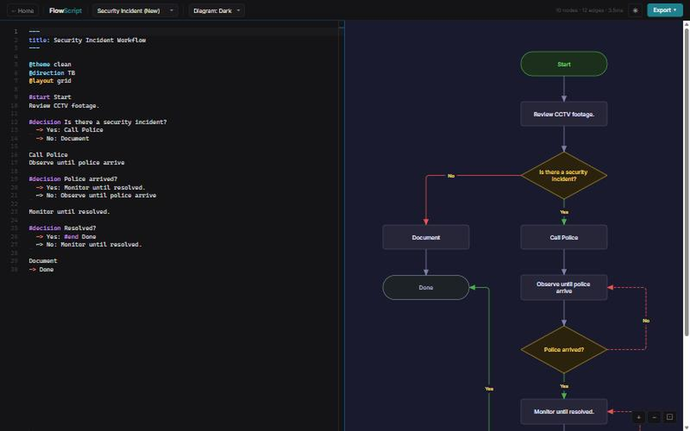

# FlowScript

Diagram-as-code for flowcharts — write readable `.flow` text, get production-quality SVG.



Flowchart tools are either click-heavy or locked into proprietary formats that break the moment someone opens them on a different machine. FlowScript compiles a human-readable DSL to clean SVG in milliseconds, and the output is a plain file that goes anywhere.

## What it does

- **Readable DSL** — decisions, branches, loops and swimlanes in indented text; no XML, no JSON, no drag
- **Live editor** — paste `.flow` source, see the diagram update in real time at [flowscript.foxanddoveconsulting.com/editor.html](https://flowscript.foxanddoveconsulting.com/editor.html)
- **Line jumps** — crossing paths get a small arc bump automatically so routes stay readable
- **MCP server** — `compile_flow` and `render_flow` tools let an LLM generate or iterate on diagrams
- **CLI** — `bun src/cli.ts <file.flow>` pipes `.flow` to SVG
- **Clean theme** — dark background, minimal palette, consistent spacing at any scale

## Quick start

Open the live editor — no install required:

[flowscript.foxanddoveconsulting.com/editor.html](https://flowscript.foxanddoveconsulting.com/editor.html)

To run locally:

```bash
bun install
bun src/cli.ts test/fixtures/incident-response.flow -o out.svg
```

Bun 1.x is the runtime. `npx tsx` works for one-off scripts if Bun is not available.

## Screenshots

The live editor with the Security Incident example loaded — left panel is `.flow` source, right panel is the rendered diagram.

## MCP server

```bash
bun src/mcp-server.ts
```

Exposes `compile_flow` (source to AST) and `render_flow` (source to SVG string). Compatible with Claude Desktop, Continue, and any MCP client.

## Building

```bash
bun run build          # compile library to dist/
bun run build:editor   # self-contained browser bundle
bun test               # run all tests
bun test --watch       # watch mode
```

## License

[Elastic License 2.0](LICENSE)

## Feedback

Questions, ideas and bug reports are welcome in [Issues](https://github.com/kilrkrow/flowscript/issues).

---

Built by Guy Schamp · [Fox & Dove](https://foxanddoveconsulting.com) · more tools at [github.com/kilrkrow](https://github.com/kilrkrow)
